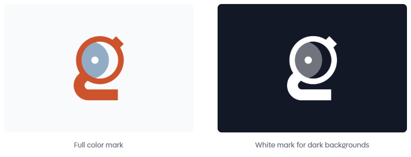
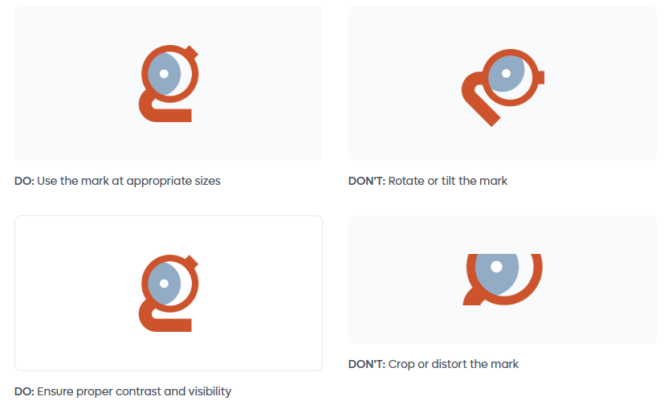

# Branding Assets and Design Guidelines

<section class="landing-section">

## Logo

The community's "g" mark with a Space Grotesk Bold wordmark in Ink. Use it for "Organized by" lines, sponsor decks, chapter material, and anything else that represents the community.

<figure class="brand-logo">

<figcaption>

**Full color** On white and cream backgrounds. [PNG](/logos/gaic/global-ai-community.png) · [SVG](/logos/gaic/global-ai-community.svg)

</figcaption>
</figure>
<figure class="brand-logo brand-logo-dark">

<figcaption>

**Reversed** On Ink and other dark backgrounds. [PNG](/logos/gaic/global-ai-community-reversed.png) · [SVG](/logos/gaic/global-ai-community-reversed.svg)

</figcaption>
</figure>
<figure class="brand-logo">

<figcaption>

**One-color ink** For single-ink printing. [PNG](/logos/gaic/global-ai-community-mono-ink.png) · [SVG](/logos/gaic/global-ai-community-mono-ink.svg)

</figcaption>
</figure>
<figure class="brand-logo brand-logo-dark">

<figcaption>

**One-color white** For single-ink printing on dark backgrounds. [PNG](/logos/gaic/global-ai-community-mono-white.png) · [SVG](/logos/gaic/global-ai-community-mono-white.svg)

</figcaption>
</figure>

PNGs are 2400 px wide with a transparent background.

<h3 id="clear-space">Clear space and minimum size</h3>

xxxx

Keep a clear space of **x** around the logo, where x is a quarter of its height. Don't use it smaller than 120 px (30 mm) wide.

**Endorsed lockup.** Next to the Global AI Conference logo, use the ready-made endorsed lockup instead of placing the two logos by hand. [Color](/logos/gaic/global-ai-conference-2027-endorsed-color.svg) · [Reversed](/logos/gaic/global-ai-conference-2027-endorsed-reversed.svg)

### Do's and Don'ts: Logo Usage

<figure class="brand-example brand-do">

<figcaption><strong>DO:</strong> Use the full-color logo on white and cream.</figcaption></figure>
<figure class="brand-example brand-dont">

<figcaption><strong>DON'T:</strong> Stretch or distort the proportions.</figcaption></figure>
<figure class="brand-example brand-do">

<figcaption><strong>DO:</strong> Use the reversed logo on Ink and other dark backgrounds.</figcaption></figure>
<figure class="brand-example brand-dont">

<figcaption><strong>DON'T:</strong> Place the logo where it lacks contrast.</figcaption></figure>
<figure class="brand-example brand-do">

<figcaption><strong>DO:</strong> Use a one-color version when you print in a single ink.</figcaption></figure>
<figure class="brand-example brand-dont">

<figcaption><strong>DON'T:</strong> Recolor the logo or apply filters and effects.</figcaption></figure>

Never rearrange or redraw the logo.

Previous logo

The previous lowercase wordmark is retired. Do not use it for new material; replace it when you update existing material. The files remain available so older material can be recognized: [previous logos (ZIP)](/logos/Global-AI-Community-Logos.zip), [full color](/logos/global-AI-community.png), [white](/logos/global-AI-community-white.png), and [semi-transparent](/logos/global-AI-community-semi-white.png).

</section>

<section class="landing-section">

## Chapter logos

Local chapters use "Global AI Community" with their city in Signal Orange. Use it for chapter pages on Meetup, LinkedIn, and Luma, and for local material. Make yours with the generator below. Questions? Ask [support@globalai.community](mailto:support@globalai.community).

### Make your chapter logo

Type your city as it appears on your chapter page. The generator sets it in Space Grotesk Regular in Signal Orange, matching the official chapter logos.

<label class="logo-generator-city">City<input name="city" type="text" maxlength="40" autocomplete="off" spellcheck="false" placeholder="Your city"></label>
<fieldset class="logo-generator-variants"><legend>Version</legend>
<label><input type="radio" name="variant" value="color" checked> Full color</label>
<label><input type="radio" name="variant" value="reversed"> Reversed</label>
<label><input type="radio" name="variant" value="mono-ink"> One-color ink</label>
<label><input type="radio" name="variant" value="mono-white"> One-color white</label>
</fieldset>

<button type="button" class="button button-ink" data-format="svg" disabled>Download SVG</button>
<button type="button" class="button button-outline" data-format="png" disabled>Download PNG (2400 px)</button>

<noscript>
The generator needs JavaScript. Ask support@globalai.community for your city's logo.
</noscript>

</section>

<section class="landing-section">

## Event banners

Announce your next event with a square 1:1 banner for LinkedIn, Instagram, Discord, and your event page. It uses your chapter logo, the brand fonts, and the brand colors. Add a real photo from your community if you have one.

### Make your event banner

<form class="event-banner-form">
<label class="logo-generator-city">City<input name="city" type="text" maxlength="40" autocomplete="off" spellcheck="false" placeholder="Your city"></label>
<label class="logo-generator-city">Program <small>(optional)</small><input name="program" type="text" maxlength="40" list="event-banner-programs" placeholder="Global AI Nights"></label>
<datalist id="event-banner-programs"><option value="Global AI Nights"><option value="Global AI Bootcamp"><option value="Global AI Connect"><option value="Global AI Construct"><option value="Global AI Community Connect"><option value="Meetup"></datalist>
<label class="logo-generator-city">Event title<input name="title" type="text" maxlength="90" autocomplete="off" placeholder="Building agents with open models"></label>

<label class="logo-generator-city">Date<input name="date" type="text" maxlength="40" autocomplete="off" placeholder="Thursday 4 February 2027"></label>
<label class="logo-generator-city">Time<input name="time" type="text" maxlength="24" autocomplete="off" placeholder="18:00–21:00"></label>

<label class="logo-generator-city">Venue<input name="venue" type="text" maxlength="70" autocomplete="off" placeholder="Venue name, street"></label>

<label class="logo-generator-city">Photo <small>(optional)</small><input name="photo" type="file" accept="image/*"></label>
<button type="button" class="button button-outline" data-clear-photo>Remove photo</button>

<fieldset class="logo-generator-variants"><legend>Background</legend>
<label><input type="radio" name="theme" value="light" checked> Cream</label>
<label><input type="radio" name="theme" value="dark"> Ink</label>
</fieldset>
</form>

<canvas width="1080" height="1080" role="img" aria-label="Event banner preview"></canvas>

<button type="button" class="button button-ink" data-download disabled>Download PNG (1080 × 1080)</button>

Your photo stays in your browser; nothing is uploaded.

<noscript>
The banner generator needs JavaScript.
</noscript>

</section>

<section class="landing-section">

## Mark

A standalone symbol for places where space is limited, or as a recognition element across touchpoints. Its circular design stands for inclusivity, continuous learning, and the interconnected global AI community.

### Usage Guidelines

- Maintain clear space around the mark equal to at least half its height
- Minimum size: 24px for digital, 0.5 inches for print
- Never alter the colors, proportions, or design elements
- Use on backgrounds that provide sufficient contrast

Downloads: [full color mark](/logos/global-AI-mark-full-color.png) · [white mark for dark backgrounds](/logos/global-AI-mark-white.png) · [all mark files (ZIP)](/logos/Global-AI-Community-Mark.zip)

### Do's and Don'ts: Mark

</section>

<section class="landing-section">

## Colors

Warm cream headers, white content, ink text, and a restrained orange accent.

<strong>Header cream</strong><code>#f5f4ec</code>Navigation, hero bands, and inset content bands

<strong>Warm cream</strong><code>#fdf0e3</code>Notices and warm callouts

<strong>Content white</strong><code>#ffffff</code>Main reading and content areas

<strong>Ink</strong><code>#16130e</code>Headlines, body text, and the dark footer

<strong>Orange</strong><code>#d5522b</code>A restrained brand accent, not a background for everything

<strong>Deep orange</strong><code>#b8431f</code>Hover states and text or controls needing stronger contrast

<strong>Logo blue</strong><code>#8cadc6</code>Supporting brand detail; the logo remains unchanged

<strong>Live green</strong><code>#178f57</code>Live status, not a general decorative accent

<strong>Muted text</strong><code>#6e6759</code>Secondary copy on light backgrounds

Deep blue `#1e224e` belongs inside the logo, not as the general page background.

</section>

<section class="landing-section">

## Typography

Both fonts are available under the SIL Open Font License. The handbook self-hosts them so reading does not depend on an external font service.

Aa

### Space Grotesk

Headings, eyebrows, statistics, and dates.

- **Display headline** · 650 · Large, confident, and short; scale down on small screens
- **Section heading** · 600 · Clear hierarchy without heavy decoration
- **Eyebrow** · 500 · Small uppercase label with letter spacing
- **Statistics and dates** · 600 · Use tabular figures when numbers align

[Get Space Grotesk](https://fonts.google.com/specimen/Space+Grotesk)

Aa

### Instrument Sans

Body text and interface labels.

- **Body text** · 400 · Comfortable reading size and generous line spacing
- **UI labels** · 500–600 · Short, direct, and readable

[Get Instrument Sans](https://fonts.google.com/specimen/Instrument+Sans)

</section>

<section class="landing-section">

## Layout, accessibility and voice

### Layout and components

- Keep navigation and hero bands on cream; let main content live on white.
- Use rounded cards, generous spacing, and clear headings rather than excessive borders and decoration.
- Buttons are pill-shaped. Use one primary action per viewport and no more than two adjacent buttons.
- Use warm notices for date changes and important guidance. Explain what the reader should do.
- Finish pages with an ink footer and a useful next step.
- Use real community photography, not stock or AI-generated event photos.
- Keep motion restrained. Respect reduced-motion preferences and let moving strips pause on hover.

### Accessibility

Maintain at least **4.5:1** contrast for normal text and **3:1** for large text. Use deep orange rather than assuming the brighter brand orange works for small text on every background. Give keyboard focus a visible outline, label controls, and never communicate status through color alone.

### Voice

Write developer-to-developer: direct, friendly, and specific. Say what happens next.

- ~~View our upcoming events~~ → Find your next event
- ~~Access our comprehensive resources~~ → Find a workshop
- ~~Contact us for further assistance~~ → Email support

Use real, verified numbers with a date when the context requires one. Do not copy sample community statistics from a design mockup into current partner materials.

</section>

<section class="landing-section landing-contact">

## Questions & Support

Archived event editions retain their original branding; do not recolor an old event kit or modify an official logo. For questions or additional brand assets, email us.

[Email support@globalai.community](mailto:support@globalai.community)

</section>
