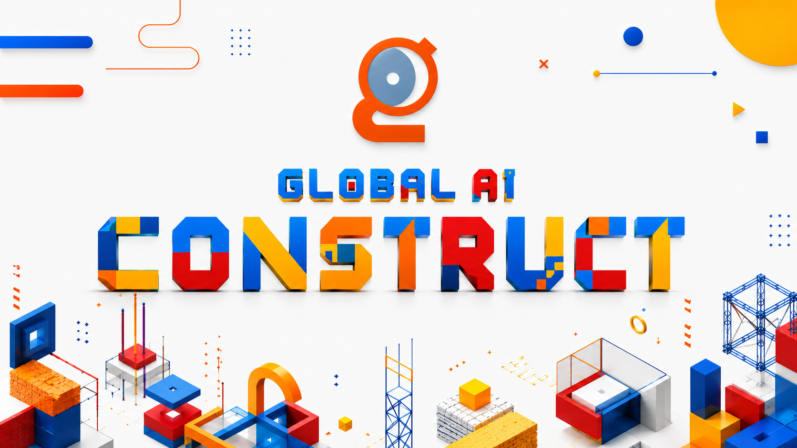

# Global AI Construct

**Stop watching. Start building.**

Global AI Construct is a hands-on event format where participants hack, build, and experiment together. No spectators—just tools, peers, and something real to demonstrate by the end of the event. The 2026/2027 season runs across chapters worldwide in July and August 2027.

## Key things to know!
- **Time frame:** July–August 2027
- **Style:** Hands-on workshop
- **Event Format:** Community driven
- **Duration:** 2 hours
- **Content:** Use the seasonal challenge pack or define a challenge for your local community.
- **Registration:** Publish on the Global AI Community platform
- **Eligibility:** This event series can only be organized by Global AI Chapter Leads.
- **Reimbursement:** Any reimbursement available for the 2027 season will be announced with the organizer pack.

## How to register your event

1. Join the Global AI Discord Channel for Organizers: [https://discord.gg/drYgzsytgV](https://discord.gg/drYgzsytgV)
2. Visit [https://globalai.community/my/events/add](https://globalai.community/my/events/add).
3. Select your chapter (you need to be logged in with your chapter email).
4. Select **Construct** event under **Global Events**.
5. Wait for event approval before publishing local campaign materials.

## Branding kit

Download the full Construct branding kit (logo, presentation template, speaker graphics, and other visual assets):

- [Download Branding Kit](/global-ai-construct-assets.zip)

## Connect with us
- Join the Global AI Discord Channel for Organizers: [https://discord.gg/drYgzsytgV](https://discord.gg/drYgzsytgV)
- Or send an email to: [support@globalai.community](mailto:support@globalai.community)
